# Actividad 1. Modelos E/R

## Ejercicio 1. Juegos de Tronos.

### 1. Entidades y relaciones.
- Entidades: Personaje y Casa.
- Relaciones: pertenece a

### 2. Frases del enunciado.
- Cada personaje pertenece a una y solo una casa. 

### 3. Modelo invididuales.

### 4. Cardinalidad.
- Cada personaje pertenece a una y solo una casa (1,1). 
- Una casa puede tener cualquier número de personajes registrados (0,n). 
- Es una relación N:1

### 5. Modelo E/R completo.
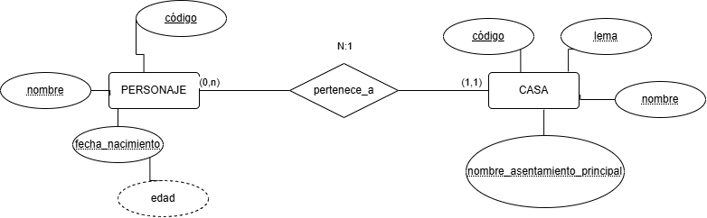

### 6. Atributos e identificadores.
- Atributos:
  - Personaje: código, nombre, fecha de nacimiento y edad.
  - Casa: código, lema y nombre de asentamiento principal.
- Identificadores:
  - Personaje: código.
  - Casa: código

### 7. Restricciones.
Dos entidades fuertes y una relación.

## Ejercicio 2. Pokémon.

### 1. Entidades y relaciones.
- Entidades: Entrenador, Ejemplar y Especie
- Relaciones: registra, corresponde

### 2. Frases del enunciado.
- Los entrenadores registran ejemplares.
- Cada ejemplar corresponde a una única especie. 

### 3. Modelo invididuales.

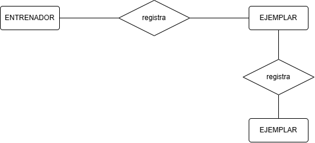

### 4. Cardinalidad.
- Un entrenador puede tener varios ejemplares de la misma especie (1,n).
- Cada ejemplar pertenece a un único entrenador (1,1).
- Cada ejemplar corresponde a una única especie (1,1).
- Puede haber especies en el catálogo que ningún entrenador haya capturado todavía (0,n)
- La relación ENTRENADOR-EJEMPLAR es 1:N y EJEMPLAR-ESPECIE es 1:N.

### 5. Modelo E/R completo.
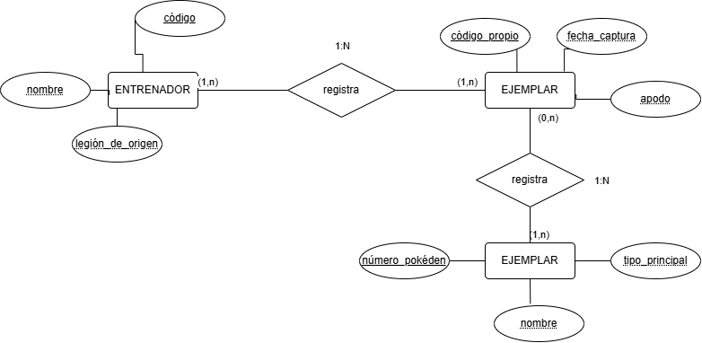

### 6. Atributos e identificadores.
- Atributos:
  - Entrenador: código, nombre, legión de origen.
  - Ejemplar: código propio, fecha de captura y apodo.
  - Especie: número pokéden, nombre y tipo principal.
- Identificadores:
  - Entrenador: código.
  - Ejemplar: código propio.
  - Especie: número pokéden.

### 7. Restricciones.
Tres entidades fuertes y dos relaciones.

## Ejercicio 3. Breaking Bad.

### 1. Entidades y relaciones.
- Entidades: Personaje y Episodio.
- Relaciones: aparece.

### 2. Frases del enunciado.
- Un personaje puede aparecer en muchos episodios. 

### 3. Modelo invididuales.

### 4. Cardinalidad.
- Un personaje puede aparecer en muchos episodios (1,n).
- Un episodio incluye al menos un personaje registrado (1,1).
- Es una relación 1:N

### 5. Modelo E/R completo.
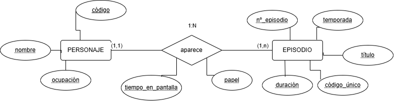

### 6. Atributos e identificadores.
- Atributos:
  - Personaje: código, ocupación y nombre.
  - aparece: tiempo en pantalla y papel.
  - Episodio: código único, duración, nº de episodio y título.
- Identificadores:
  - Personaje: código.
  - Episodio: código único.

### 7. Restricciones.
Dos entidades fuertes y una relación.

## Ejercicio 4. Minecraft.

### 1. Entidades y relaciones.
- Entidades: Jugador, Construcción y Mundo.
- Relaciones: colabora en, tiene

### 2. Frases del enunciado.
- Varios jugadores pueden colaborar en una construcción.
- Un mundo puede existir aunque todavía no tenga construcciones.

### 3. Modelo invididuales.
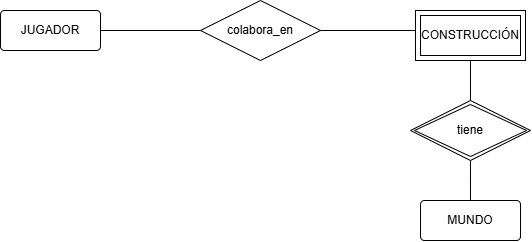

### 4. Cardinalidad.
- Varios jugadores pueden colaborar en una construcción (1,n).
- Un jugador puede colaborar en varias construcciones (1,n).
- Un mundo puede existir aunque todavía no tenga construcciones (0,n).
- El número de construcción solo es único dentro de su mundo (1,1).
- La relación JUGADOR-CONSTRUCCION es N:M y CONSTRUCCION-MUNDO es 1:N.

### 5. Modelo E/R completo.
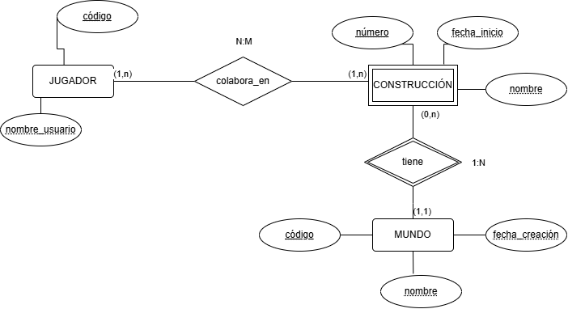

### 6. Atributos e identificadores.
- Atributos:
  - Jugador: código y nombre usuario.
  - Construcción: número, nombre y fecha de inicio.
  - Mundo: código, nombre y fecha de creación.
- Identificadores:
  - Jugador: código.
  - Construcción: número.
  - Mundo: código.
 
### 7. Restricciones.
Dos entidades fuertes, una entidad débil, una relación y una relación identificadora

## Ejercicio 5. Fortnite.

### 1. Entidades y relaciones.
- Entidades: Partida, Jugador y Escuadrón.
- Relaciones: participa en, pertenece a 

### 2. Frases del enunciado.
- Un jugador puede participar en muchas partidas.
- Un jugador puede pertenecer a un escuadrón.

### 3. Modelo invididuales.

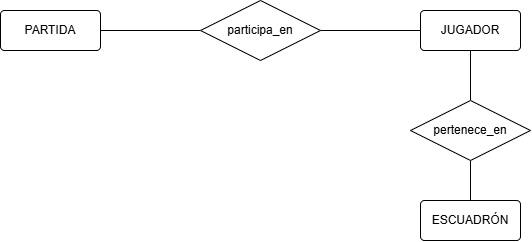

### 4. Cardinalidad.
- Cada partida registrada tiene al menos dos jugadores (2,n).
- Un jugador participa una sola vez en una misma partida. Es posible que un jugador recién registrado todavía no haya disputado ninguna (0,n).
- Un jugador puede pertenecer a un escuadrón como máximo (0,1).
- Un escuadrón puede tener varios jugadores (0,n).
- La relación PARTIDA-JUGADOR es N:M y JUGADOR-ESCUADRON es 1:N.

### 5. Modelo E/R completo.
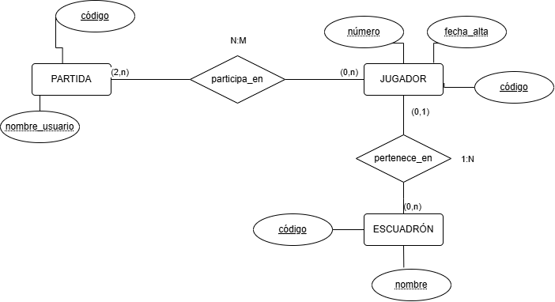

### 6. Atributos e identificadores.
- Atributos:
  - Partida: código, modo de juego, fecha y hora.
  - Jugador: código, número y fecha de alta.
  - Escuadrón: código y nombre.
- Identificadores:
  - Partida: código.
  - Jugador: código.
  - Escuadrón: código.

### 7. Restricciones.
Tres entidades fuertes y dos relaciones.

## Ejercicio 6. Arcane.

### 1. Entidades y relaciones.
- Entidades: Personaje y Lugar.
- Relaciones: tiene hermano, visita

### 2. Frases del enunciado.
- Un personaje puede visitar varios lugares.
- Un personaje puede no tener hermanos registrados o tener varios. 

### 3. Modelo invididuales.

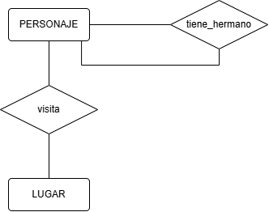

### 4. Cardinalidad.
- Un personaje puede no tener hermanos registrados o tener varios (0,n).
- Un personaje puede visitar varios lugares y un lugar puede ser visitado por varios personajes. Se registra como máximo una visita por cada pareja personaje-lugar (1,n).
- La relación PERSONAJE-PERSONAJE es N:M y PERSONAJE-LUGAR es N:M.

### 5. Modelo E/R completo.
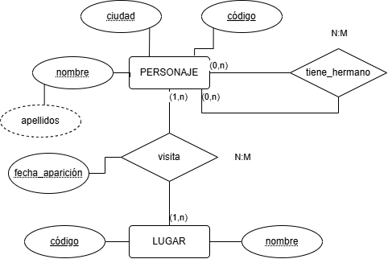

### 6. Atributos e identificadores.
- Atributos:
  - Personaje: código, ciudad, nombre y apellidos.
  - Lugar: código y nombre.
  - visita: fecha aparición.
- Identificadores:
  - Personaje: código.
  - Lugar: código

### 7. Restricciones.
Dos entidades fuertes y dos relaciones.

## Ejercicio 7. Elden Ring.

### 1. Entidades y relaciones.
- Entidades: Zona, Jefe y Jugador.
- Relaciones: aparece, derrota.

### 2. Frases del enunciado.
- Cada jefe aparece en una sola zona de esta guía.
- Un jugador puede derrotar a muchos jefes

### 3. Modelo invididuales.

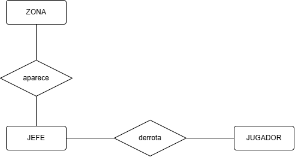

### 4. Cardinalidad.
- Cada jefe aparece en una sola zona de esta guía (1,1).
- Una zona puede tener varios jefes o ninguno (0,n).
- Un jugador puede derrotar a muchos jefes, (0,n) y cada jefe puede ser derrotado por muchos jugadores (0,n). Un jugador nuevo puede no haber derrotado a ninguno.
- La relación ZONA-JEFE es 1:M y JEFE-JUGADOR es N:M.

### 5. Modelo E/R completo.
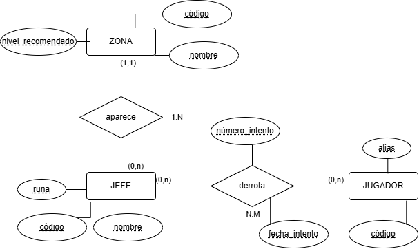

### 6. Atributos e identificadores.
- Atributos:
  - Zona: código, nombre y nivel recomendado.
  - Jefe: código, runa y nombre.
  - Jugador: código y alias.
  - derrota: número intento y fecha intento
- Identificadores:
  - Zona: código.
  - Jefe: código.
  - Jugador: código.

### 7. Restricciones.
Dos entidades fuertes y dos relaciones.

## Ejercicio 8. Valorant.

### 1. Entidades y relaciones.
- Entidades: Jugador, Partida y Agente.
- Relaciones: utiliza

### 2. Frases del enunciado.
- Un jugador puede disputar muchas partidas y utilizar distintos agentes en ellas. 

### 3. Modelo invididuales.

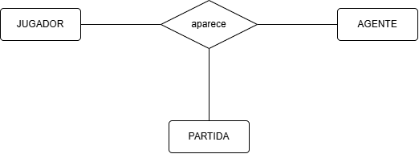

### 4. Cardinalidad.
- Un jugador puede disputar muchas partidas y utilizar distintos agentes en ellas (0,n).
- Un agente puede ser utilizado por muchos jugadores y aparecer en muchas partidas. Cada jugador que participa en una partida utiliza exactamente un agente en ella (1,n).
- Una partida debe contar con al menos un jugador, pero se permite registrar jugadores y agentes que todavía no hayan intervenido en ninguna partida (1,n).
- La relación JUGADOR-AGENTE es N, JUGADOR-PARTIDA es N y PARTIDA-AGENTE es N.

### 5. Modelo E/R completo.
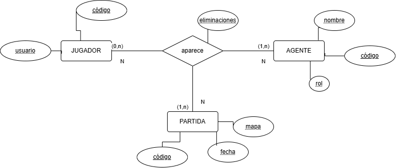

### 6. Atributos e identificadores.
- Atributos:
  - Jugador: código y usuario.
  - Partida: código, fecha y mapa.
  - Agente: código, nombre y rol
  - utiliza: eliminaciones
- Identificadores:
  - Jugador: código.
  - Partida: código.
  - Agente: código.

### 7. Restricciones.
Tres entidades fuertes y una relación.

## Ejercicio 9. Nintendo.

### 1. Entidades y relaciones.
- Entidades: Personaje y Casa.
- Relaciones: pertenece a

### 2. Frases del enunciado.
- Cada personaje pertenece a una y solo una casa. 

### 3. Modelo invididuales.

### 4. Cardinalidad.
Cada personaje pertenece a una y solo una casa (1,1). Una casa puede tener cualquier número de personajes registrados (0,n). Es una relación N:1

### 5. Modelo E/R completo.

### 6. Atributos e identificadores.
- Atributos:
  Personaje: código, nombre, fecha de nacimiento y edad.
  Casa: código, lema y nombre de asentamiento principal.
- Identificadores:
  Personaje: código.
  Casa: código

### 7. Restricciones.
Dos entidades y una relación.

